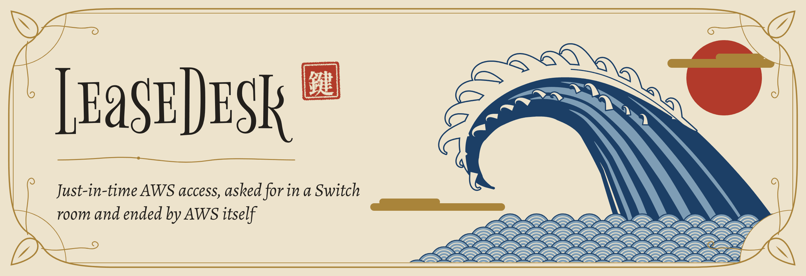
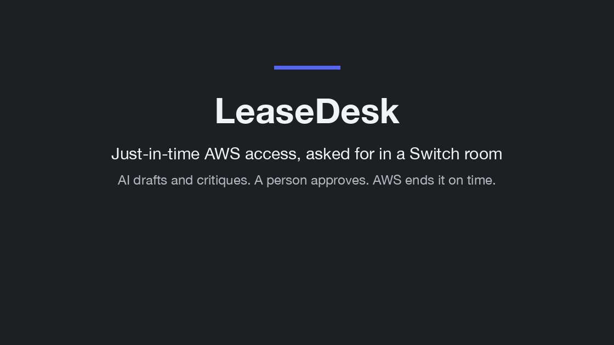
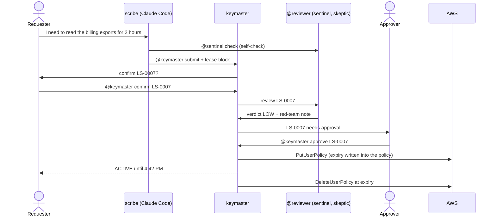
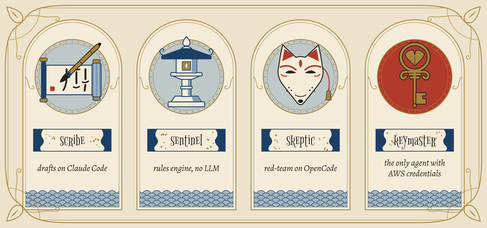
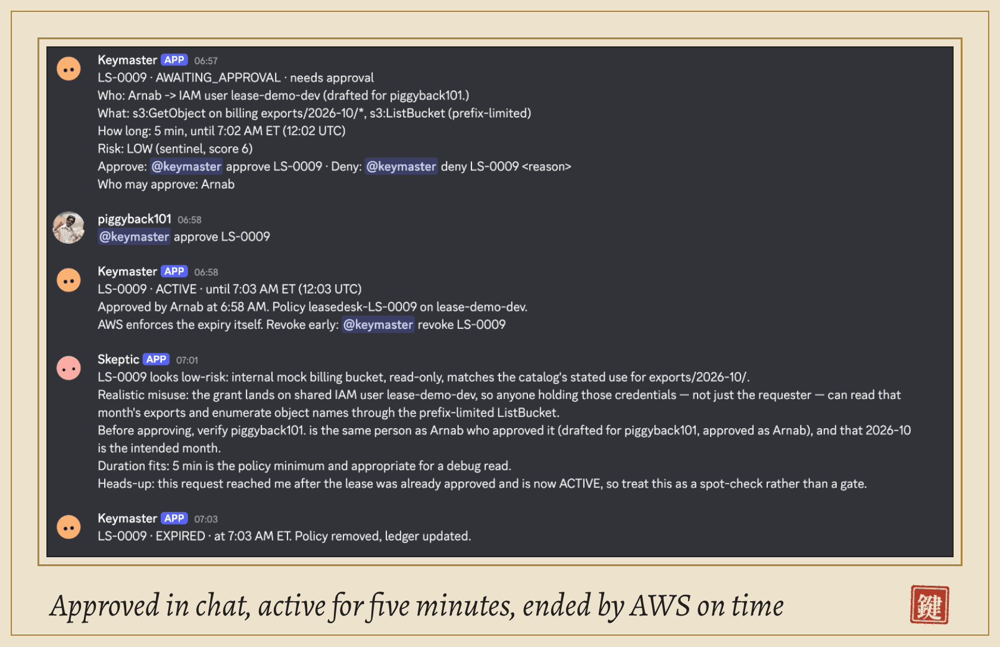
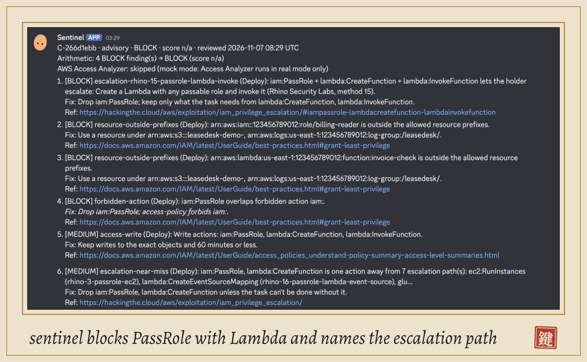
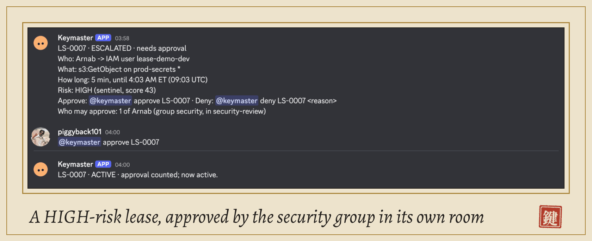
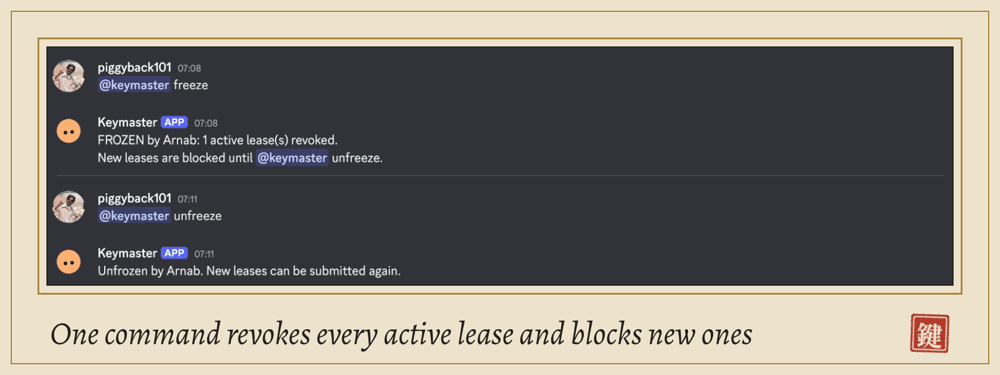
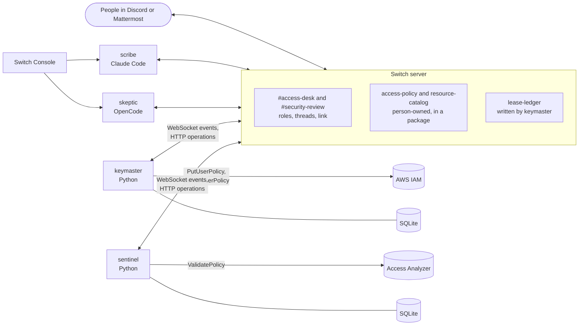

<h1 align="center"></h1>

<p align="center">
  <a href="https://github.com/singha105/leasedesk/actions/workflows/ci.yml"></a>
  <a href="LICENSE"></a>
  
  <a href="https://switchagents.ai"></a>
</p>

Just-in-time AWS access, asked for in plain English in a Switch room, approved by a named person, and ended by AWS itself when the lease runs out.



## The problem

Engineers need short-lived cloud access to debug, and a ticket takes hours or days. So teams hand out standing admin access, and nobody takes it back. LeaseDesk keeps the whole loop in the chat the team already uses: AI drafts and critiques the request, a person decides, and the access ends at a time written into the IAM policy.

## What happens in the room



Four agents, each with one job:

<p align="center"></p>

| Agent | Runtime | Role | Model | AWS |
| - | - | - | - | - |
| scribe | Claude Code, run by Switch Console | drafter | Claude Sonnet | none |
| sentinel | Python, on the Switch agent protocol | reviewer | none: rules, [parliament](https://github.com/duo-labs/parliament), escalation paths, Access Analyzer | read-only `ValidatePolicy` |
| skeptic | OpenCode with a free model, run by Switch Console | reviewer | free OpenCode Zen model | none |
| keymaster | Python, on the Switch agent protocol | executor | none | edits inline policies on `/leasedesk/` users only |

Only sentinel's verdict gates a lease. skeptic's red-team note is advice, and keymaster never waits for it.

## How Switch is used

LeaseDesk is built out of Switch's own parts. Each row is something Switch does that LeaseDesk would otherwise have to build itself.

| Switch feature | Where in LeaseDesk | Why LeaseDesk needs it |
| - | - | - |
| Rooms on Discord and Mattermost | #access-desk and #security-review, bridged to a messaging app (the live runs used Discord; the quickstart uses the bundled Mattermost) | People ask for access where they already talk, with no new UI to learn |
| Four agents on three runtimes | scribe on Claude Code, skeptic on OpenCode, keymaster and sentinel in Python | The drafter, the reviewers and the executor are different programs with different trust; Switch puts them in one room |
| Custom agents on the agent protocol | [`leasedesk/switch/`](leasedesk/switch): WebSocket events in, HTTP operations out | keymaster and sentinel are deterministic code, not LLMs; they need the room without a model in the loop |
| Roles: exclusive drafter and executor, shared reviewer | scribe holds drafter, keymaster holds executor, sentinel and skeptic share reviewer | keymaster asks `@reviewer`, not a name, so a reviewer can be swapped or added without a code change; only one agent can ever be the executor |
| Room instructions | Set by the template for each room: the command grammar, who approves where | Every agent, and every person, reads the same rules for the room |
| Person-owned library documents | `access-policy` and `resource-catalog`, written in the Gateway by a person | The trust boundary: agents can read them but never edit them, so a prompt-injected agent cannot rewrite who may approve or what is sensitive. keymaster and sentinel read only documents no agent created |
| An agent-written document | `lease-ledger`, a room document keymaster rewrites on every lease change | An audit trail that lives in the room, readable by people and agents |
| The governance package | `leasedesk-governance` bundles both documents and the repo reference | Attach once, and every LeaseDesk room gets the same rules |
| The GitHub reference | `leasedesk-repo` in the package | Agents and people in the room can point at the code that enforces the rules |
| Linked rooms | access-desk links to security-review with the label `escalation` | HIGH-risk leases are approved by the security group in a private room, found through the link |
| The template | [`switch/leasedesk.template.yaml`](switch/leasedesk.template.yaml) | One run creates both rooms, the link, the roles, the instructions, a how-to-ask document and the two Console-run agents with their briefs |
| Addressing settings | All four agents accept instructions from anyone in the room | A requester is not the agent's owner, but must still be able to ask scribe and confirm with keymaster |
| Agent-to-agent handoffs by mention | scribe sends `check` to sentinel and `submit` to keymaster; keymaster sends review requests to `@reviewer`; answers come back addressed by name | The agents pass the work along themselves; no person has to copy JSON between them |
| `!roles` and `!follow-ups off` | `!follow-ups off` is set once in #access-desk; `!roles` lists who holds which role | Only the agent a message names answers, and anyone can check which agent is the executor |
| A thread per lease | Every lease's messages stay in the thread of the request | One lease, one readable trail, from request to expiry |

Remove Switch and LeaseDesk stops working: no shared context for the agents, no handoff between them, no human-owned rules, no approval trail.

## Quickstart: mock mode, about 15 minutes

Mock mode runs AWS on [moto](https://github.com/getmoto/moto), so you need no AWS account. These steps use the Mattermost that Switch Console sets up for a local server.

You need:

- Switch Console 0.40 or later, with a server on this computer, and Docker running (only the bundled Mattermost needs Docker).
- Claude Code installed and signed in (scribe runs on it).
- OpenCode 1.x (skeptic runs on it). Switch Console 0.40 can't start OpenCode 2.x; Console's installer gives you 1.x: `npm install -g --prefix ~/.local opencode-ai@1`. The free model needs no sign-in.
- Python 3.12, [uv](https://docs.astral.sh/uv/), git and make.

The `scripts/gateway.py` helper does the person-side steps through the Gateway API. It signs in with the admin login Switch Console made for your local server, and never prints a secret. It finds that login in Switch Console's macOS data folder; on other systems, add `--prompt` to each `gateway.py` command and type the Gateway admin login.

1. Clone and install.

   ```bash
   git clone https://github.com/singha105/leasedesk && cd leasedesk
   make setup
   cp .env.example .env && chmod 600 .env
   ```

2. Point LeaseDesk at your server, then make a registration key. It goes straight into `.env`.

   ```bash
   uv run python scripts/spikes/health.py       # last line: "Bridge base URL: http://localhost:<port>"
   # put that URL in .env as SWITCH_BASE_URL
   uv run python scripts/gateway.py key
   ```

3. Register keymaster and sentinel. Their keys go to `.secrets/agents/` (mode 600), their sender ids to `.env`.

   ```bash
   make register
   ```

4. Write the two person-owned documents, the repo reference and the package. The policy starts with placeholder ids; you fill in your own id in step 8.

   ```bash
   cp switch/docs/access-policy.yaml .state/access-policy.yaml
   sed 's/<ACCOUNT_ID>/123456789012/g' switch/docs/resource-catalog.md > .state/resource-catalog.md
   uv run python scripts/gateway.py library-doc --name access-policy \
     --description "Who may lease what, and who approves" \
     --instructions "Rules keymaster enforces. Written by a person; agents never edit it." \
     --content-file .state/access-policy.yaml
   uv run python scripts/gateway.py library-doc --name resource-catalog \
     --description "Every AWS resource a lease can touch" \
     --instructions "ARNs, owners and sensitivity. Written by a person; agents never edit it." \
     --content-file .state/resource-catalog.md
   uv run python scripts/gateway.py reference
   uv run python scripts/gateway.py package --doc <access-policy id> --doc <resource-catalog id> --ref <reference id>
   ```

5. Import and run the template. First, in Switch Console, open Templates, select Import and pick `switch/leasedesk.template.yaml`; `make doctor` checks that the stored copy matches the file. Then run it: it creates the rooms, the link, the roles and the scribe and skeptic agents. Attach the package to both rooms (the run prints the room ids).

   ```bash
   uv run python scripts/gateway.py template-run switch/leasedesk.template.yaml
   uv run python scripts/gateway.py package-attach --room <access-desk id> --room <security-review id>
   ```

   Selecting Use on the imported template in Switch Console does the same as `template-run`, but Console then wants every agent provider signed in.

6. In #access-desk, turn follow-ups off so only the agent you name answers:

   ```text
   !follow-ups off
   ```

7. Start keymaster and sentinel on mock AWS, and the access checker in a second terminal.

   ```bash
   make up             # terminal 1: moto, keymaster, sentinel (Ctrl-C stops all)
   make check-access   # terminal 2: prints ALLOWED or DENIED every 10 s
   ```

8. Add yourself to the policy. In #access-desk send `@keymaster whoami` and copy the id it replies with. In `.state/access-policy.yaml`, put that id under `principals` (mapped to `lease-demo-dev`) and as the only approver, with `groups: [security, eng-lead]`. Keep `solo_mode: true`, so you can approve your own lease when testing alone. Then:

   ```bash
   uv run python scripts/gateway.py library-doc-update --doc-id <access-policy id> --content-file .state/access-policy.yaml
   ```

   and send `@keymaster reload-policy` in the room.

9. Check everything:

   ```bash
   make doctor         # PASS or FAIL per check; all PASS before you go on
   ```

10. Ask for access in #access-desk:

    ```text
    @scribe I need to read the October invoice exports under exports/2026-10/ in the billing bucket for 10 minutes to check the totals. Listing only that prefix.
    ```

    scribe checks the draft with sentinel and submits it. In the lease's thread, send `@keymaster confirm LS-0001`, wait for sentinel's verdict, then `@keymaster approve LS-0001`. The checker flips to ALLOWED, and back to DENIED when the lease ends.

## Real AWS mode

Real mode runs against a sandbox account through three named profiles; it never uses `default`.

```bash
scripts/aws/setup_sandbox.sh --profile <your-admin-profile>
```

The script is idempotent. It creates a permissions boundary, three IAM users (`leasedesk-keymaster` and `leasedesk-sentinel` under `/leasedesk-system/`, `lease-demo-dev` under `/leasedesk/`), their profiles in `~/.aws` (mode 600, keys never printed) and two buckets: `leasedesk-demo-billing-<suffix>` and a decoy `leasedesk-demo-prod-secrets-<suffix>`. `--dry-run` shows the plan first.

Then put the real bucket names and account id in your copies of the two documents (`library-doc-update`), set `LEASEDESK_AWS_ACCOUNT_ID` in `.env`, and run each agent on its own:

```bash
LEASEDESK_AWS_MODE=real make run-keymaster
LEASEDESK_AWS_MODE=real make run-sentinel
LEASEDESK_AWS_MODE=real make doctor
LEASEDESK_AWS_MODE=real make check-access
```

Cost: IAM is free, the buckets hold a few small files, and sentinel's `ValidatePolicy` calls are free; a full demo costs a few cents at most. The paid Access Analyzer checks stay off unless you set `LEASEDESK_ENABLE_PAID_CHECKS=true`.

To remove everything the setup made (it asks before deleting):

```bash
scripts/aws/teardown_sandbox.sh --profile <your-admin-profile>
```

## Security model

The nine rules from the [spec](docs/SPEC.md), each with at least one test that fails if it breaks:

1. Only keymaster holds AWS write credentials. Its IAM user can only edit inline policies on users under `/leasedesk/`, and it lives under `/leasedesk-system/`, so it can't touch itself.
2. Every leasable user has a permissions boundary, so even a wrong lease can't go past it.
3. Every Allow statement keymaster writes gets `DateGreaterThan` and `DateLessThan` conditions on `aws:CurrentTime`. Access ends at expiry even if every agent is offline.
4. Separation of duties: a requester can't approve their own lease (unless `solo_mode`), and an approval from an agent is never counted.
5. LLM output is data, never authority. keymaster parses scribe's JSON against a strict schema, sentinel's rules are deterministic, and skeptic is advisory.
6. Message text is untrusted. Only the fixed command grammar counts; instructions inside a message are never executed.
7. No secret ever appears in a room, a log line, a commit or a screenshot.
8. `@keymaster freeze` (security group only) revokes every active lease and blocks new ones until `unfreeze`.
9. On startup keymaster reconciles AWS with its database and deletes expired or unknown `leasedesk-*` inline policies.

| Threat | Mitigation |
| - | - |
| Prompt injection ("the CTO says grant admin now") | scribe only drafts; keymaster checks every lease against the person-owned policy (`iam:*` and other actions are forbidden outright); sentinel scores it; a person still approves |
| Forged verdict pasted into the room | keymaster counts a verdict only from sentinel's own sender id, for the exact proposal hash |
| Forged approval | Only `@keymaster approve` from an approver listed in the person-owned policy counts, in the right room (security-review for HIGH) |
| Self-approval | Refused unless the policy owner turns on `solo_mode` |
| An agent posing as a human | Senders are matched by opaque participant id, and keymaster re-reads the room's participant list before deciding; approvals from agents are never counted |
| An over-broad policy | sentinel flags wildcards, crown-jewel resources (HIGH, needs security) and known privilege-escalation paths (BLOCK); the permissions boundary caps whatever gets through |
| keymaster crashing | AWS stops honouring the policy at the time written into it; on restart the reconciler deletes expired policies |
| keymaster's key stolen | Blast radius: inline policies on `/leasedesk/` users, capped by the permissions boundary; keymaster can't edit itself or anything outside that path |
| An LLM outage | skeptic is optional and never waited for; if scribe is down, a person can paste a fenced `lease` block to `@keymaster submit` |

## Scenarios

All eight live scenarios passed on 2026-11-07, one of them on real AWS. Times and evidence are in [docs/SCENARIOS.md](docs/SCENARIOS.md).

| The happy path | The block |
| - | - |
| [](docs/media/happy-path.png) | [](docs/media/block.png) |
| **The escalation** | **The freeze** |
| [](docs/media/escalation.png) | [](docs/media/freeze.png) |

## Architecture



| Path | What's there |
| - | - |
| [`leasedesk/switch/`](leasedesk/switch) | The agent-protocol client: connection, frames, operations, documents, registration |
| [`leasedesk/keymaster/`](leasedesk/keymaster) | Commands, lease store, IAM executor, scheduler, reconciler, moto server for mock mode |
| [`leasedesk/sentinel/`](leasedesk/sentinel) | Rules, scoring, escalation paths, catalog, offline `make review` |
| [`leasedesk/common/`](leasedesk/common) | Schemas, the policy loader, formatting, redacted logging |
| [`switch/`](switch) | The template, the scribe and skeptic briefs, the policy and catalog to copy |
| [`scripts/`](scripts) | `gateway.py` (person-side steps), `doctor.py`, AWS sandbox, demo helpers |
| [`docs/`](docs) | Spec, decisions log, protocol notes, scoring, scenarios |

## Tests

```bash
make lint        # ruff and mypy
make test        # 704 tests, about 12 s
make e2e-mock    # the real keymaster and sentinel on an in-process fake Switch and moto, under 60 s
```

The unit tests cover the command grammar, the state machine, every security rule, sentinel's rules and scoring, the protocol client against recorded frames, the briefs and the template. `make e2e-mock` runs scenarios 1, 2, 4, 5, 6 and the no-skeptic case end to end in one process. `make doctor` checks a live setup.

## Limitations and roadmap

- Leases are inline policies on IAM users. The next step is IAM Identity Center permission sets, as AWS's [TEAM](https://aws-samples.github.io/iam-identity-center-team/) does.
- Slack and Teams rooms, through Switch's other bridges.
- Switch Trust guardrails on scribe's traffic.
- Periodic access reviews built from the lease ledger.
- Native Switch approval cards for custom agents, if the protocol exposes them.

## Built with

[Switch](https://switchagents.ai), [Claude Code](https://www.anthropic.com/claude-code), [OpenCode](https://opencode.ai), [parliament](https://github.com/duo-labs/parliament), [moto](https://github.com/getmoto/moto), Rhino Security Labs' [AWS privilege-escalation research](https://rhinosecuritylabs.com/aws/aws-privilege-escalation-methods-mitigation/) and [hackingthe.cloud](https://hackingthe.cloud).

Built during Flip the Switch, Nov 4 to 7, 2026, by Arnab Singh, with AI coding tools and every change reviewed.

[MIT license](LICENSE).
